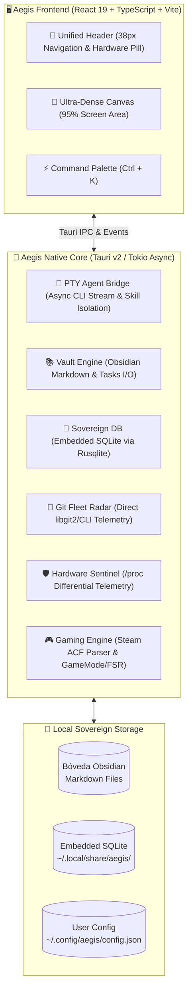

# 🛡️ Aegis — The Sovereign Cognitive Desktop Cockpit

<div align="center">


**A sovereign, hyper-efficient personal operating cockpit and command center engineered in Rust and React 19.**  
*Unified AI Agents, Obsidian Second Brain, Git Fleet DevOps, Sovereign SQLite Finances, and Real-Time Hardware Telemetry in a 38px ultra-dense canvas.*

[Explore Architecture](#-architecture) • [The 8 Pillars](#-the-8-pillars) • [User Guide](docs/USER_GUIDE.md) • [Benchmarks](#-benchmarks--performance) • [Quickstart](#-quickstart--compilation)

</div>

---

## 🎯 Executive Overview

Modern software engineers suffer from extreme cognitive fragmentation: bouncing between an IDE, terminal CLI AI tools, markdown note-taking apps, system performance monitors, gaming launchers, and personal finance spreadsheets.

**Aegis** consolidates this entire workflow into a **single, unified, local-first desktop application**. Engineered with **Tauri v2** and **Rust**, it delivers native system performance with zero remote telemetry, zero third-party cloud lock-in, and an ultralight memory footprint of **~48–52 MB RAM** (less than an empty Chrome tab).

---

## 🏗️ Architecture

Aegis is built around a sovereign **local-first** model: all data remains strictly on your local NVMe storage, stored either in human-readable Markdown or zero-overhead SQLite.



---

## 🛡️ The 8 Pillars

1. **🤖 Omnichannel AI Agent (`Alt + 1`)**
   - Direct PTY stream bridge to local CLI agents (`agy`, Claude Code, Ollama).
   - Dynamic context isolation: reduces token consumption by **~60%** (from ~25k to ~6.9k tokens base) by symlinking only the active skills.
   - Dual cognitive effort toggle: **Flash** (rapid execution) vs **Profundo** (deep reasoning).
2. **💰 Sovereign Finances & Timeline (`Alt + 2`)**
   - Native embedded SQLite engine (`aegis_lifeos.db`) replacing browser IndexedDB.
   - Multi-domain master timeline: intertwines software sprints, operational commitments, certifications, and personal milestones.
   - Monthly calendar with domain category badges and daily expense breakdown.
3. **📚 Obsidian Second Brain (`Alt + 3`)**
   - Direct bidirectional synchronization with local Obsidian Vault.
   - Collapsible hierarchical folder tree (`Ctrl + B`), live hot-reload Markdown editor, and native **Mermaid diagrams** renderer.
   - Instant search with deep link jumping.
4. **🚀 DevOps & Git Fleet Radar (`Alt + 4`)**
   - Real-time Git status across your entire project fleet (active branches, dirty states, ahead/behind counters, last commit metadata).
   - Safety gates (strict warnings against dangerous operations in critical repositories).
   - Dynamic catalog of installed Agent Skills with search and `SKILL.md` viewer.
5. **📋 Daily Workflow & Tasks (`Alt + 5`)**
   - High-speed parser extracting `- [ ]` and `- [x]` markdown tasks across the entire vault.
   - Atomic disk toggling: checking a box in Aegis instantly edits the physical markdown file with zero latency.
6. **🛡️ Hardware Sentinel (`Alt + 6`)**
   - Zero-overhead ($O(1)$) telemetry reading directly from Linux `/proc/stat`, `/proc/meminfo`, and `/sys/class/thermal`.
   - Real-time per-core breakdown, CPU thermal sensor with throttling alerts, DDR5 RAM + compressed ZRAM monitoring.
   - Integrated Process Killer: inspect top memory-consuming processes and terminate runaway tasks with 1-click.
7. **🎮 Gaming Nexus & Optimization (`Alt + 7`)**
   - Steam local library auto-discovery: parses `appmanifest_*.acf` without needing the Steam client open.
   - 1-Click GameMode (`gamemoded -s`) and Gamescope FSR upscaling integration (720p 60fps $\to$ 1080p).
   - Launchers for lightweight native Wayland titles, emulators, and local game libraries.
8. **⚙️ Master Settings & Sovereign Config (`Ctrl + ,`)**
   - Dynamic configuration stored in `$XDG_CONFIG_HOME/aegis/config.json`.
   - 5 Reactive UI Themes: *Nordic Slate & Moss*, *Tokyo Night*, *OLED Pure Black*, *Amber Terminal*, and *Dracula Dark*.
   - Editable Git fleet, customizable vault paths, and AI engine selector.

---

## ⚡ Benchmarks & Performance

Aegis was specifically engineered and battle-tested on ultra-efficient, resource-constrained hardware (**Intel Processor N150, 4 Gracemont E-cores, 16 GB DDR5, Fedora Linux 43 Wayland**):

| Metric | Aegis (Tauri v2 + Rust) | Typical Electron App | Delta |
|---|---|---|---|
| **Idle Memory (VmRSS)** | **~48 – 52 MB** | 420 – 680 MB | **~89% less RAM** |
| **Startup Time (Cold Launch)** | **~180 ms** | 1,800 – 3,200 ms | **10x faster** |
| **Binary Size (Standalone)** | **17.2 MB** | 140 – 210 MB | **~90% smaller** |
| **Hardware Telemetry Cost** | **$O(1)$ ($<0.1\%$ CPU)** | 2 – 5% CPU polling | **Imperceptible overhead** |
| **Network Sockets (Offline)** | **0 open sockets** | Continuous telemetry pings | **100% Sovereign** |

---

## ⌨️ Tactical Keyboard Shortcuts

| Shortcut | Action | Scope |
|---|---|---|
| <kbd>Ctrl</kbd> + <kbd>K</kbd> | Open Command Palette / Omnibar | Global |
| <kbd>Alt</kbd> + <kbd>1</kbd> .. <kbd>7</kbd> | Jump directly to Pillars 1 – 7 | Global |
| <kbd>Alt</kbd> + <kbd>Z</kbd> | Toggle Zen Mode (Full canvas view) | Global |
| <kbd>Ctrl</kbd> + <kbd>,</kbd> | Open Global Settings & Theme Switcher | Global |
| <kbd>Ctrl</kbd> + <kbd>B</kbd> | Toggle Obsidian Vault File Tree Sidebar | Vault View |
| <kbd>Ctrl</kbd> + <kbd>S</kbd> | Atomic Save Note to Disk | Vault Editor |
| <kbd>Esc</kbd> | Close Modal / Exit Zen Mode / Cancel Palette | Global |

---

## ⚡ Instant Installation (Linux)

Install or update the latest precompiled release, register the desktop launcher, and download official tactical icons with a single sovereign command (no root required):

```bash
curl -fsSL https://raw.githubusercontent.com/GabrielSa8/Aegis/main/scripts/install.sh | bash
```

*Or via `wget`:*
```bash
wget -qO- https://raw.githubusercontent.com/GabrielSa8/Aegis/main/scripts/install.sh | bash
```

> **Requirements:** 64-bit Linux (Fedora, Debian, Ubuntu, Arch) with `webkit2gtk-4.1`. The script checks dependencies, installs binary to `~/.local/bin/aegis`, and creates `~/.local/share/applications/aegis.desktop`.
> To uninstall at any time: `curl -fsSL https://raw.githubusercontent.com/GabrielSa8/Aegis/main/scripts/install.sh | bash -s -- --uninstall`

---

## 🚀 Manual Compilation from Source

### Prerequisites
- **Linux** (Fedora, Ubuntu, Arch, Debian) with Wayland or X11.
- **Rust toolchain** (`cargo`, `rustc` 1.80+): `curl --proto '=https' --tlsv1.2 -sSf https://sh.rustup.rs | sh`
- **Node.js** (v18+) & `npm`: for Vite frontend compilation.
- **System WebKit libraries**:
  - Fedora/RHEL: `sudo dnf install webkit2gtk4.1-devel openssl-devel libappindicator-gtk3-devel`
  - Ubuntu/Debian: `sudo apt install libwebkit2gtk-4.1-dev libssl-dev libappindicator3-dev`
  - Arch Linux: `sudo pacman -S webkit2gtk-4.1 openssl`

### 1. Clone & Install Dependencies
```bash
git clone https://github.com/GabrielSa8/Aegis.git aegis
cd aegis
npm install
```

### 2. Run in Development Mode
```bash
npm run tauri:dev
```

### 3. Build Autonomous Release Binary (Zero Node/Vite Dependencies)
```bash
npm run tauri -- build --no-bundle
```
The standalone binary will be generated at `src-tauri/target/release/aegis` (~17 MB).

---

## 🎨 Design System

Aegis follows the **Nordic Slate & Moss** design ethos detailed in [`DESIGN.md`](./DESIGN.md):
- **Maximum High-Density Utility**: Eliminates bloated white space; ensures 95% of screen area is usable content.
- **OLED & Night Ergonomics**: Deep slate backgrounds (`#0a0d0c`, `#0f1412`) paired with sage moss accents (`#10b981`, `#34d399`) for all-day eye comfort.
- **Tactile Typography**: Clean monospace numbers for financial balances, telemetry gauges, and code blocks.

---

## 📜 License

Distributed under the **MIT License**. See [`LICENSE`](./LICENSE) for full details.

Developed with precision by **Gabriel** ([@GabrielSa8](https://github.com/GabrielSa8)).
